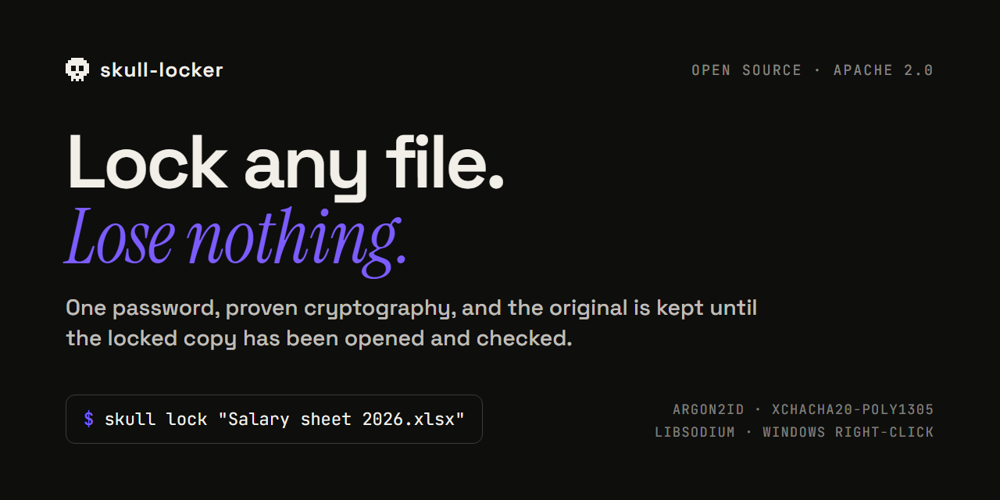
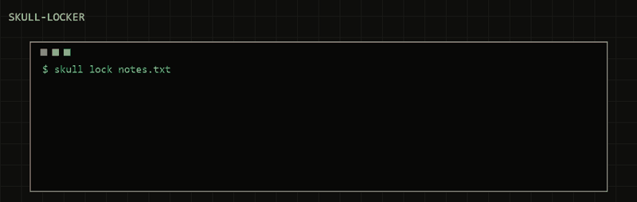

<p align="center">
  
</p>

<p align="center">
  <b>Lock any file with a password. Right-click, type it twice, done.</b><br>
  Only proven cryptography (libsodium: Argon2id + XChaCha20-Poly1305), and the original is never deleted
  until the locked copy has been unlocked and checked.
</p>

<p align="center">
  <a href="https://github.com/skull-org/skull-locker/actions/workflows/ci.yml"></a>
  
  
  
</p>

---

<p align="center">
  
</p>

```console
$ pip install git+https://github.com/skull-org/skull-locker
$ skull lock "Salary sheet 2026.xlsx"
Password:
Again:
Make a recovery key? [Y/n] y
RECOVERY KEY - write it down, it is shown only once:
  3f9a1c0e 7b2d44a1 ...
Type group 5 of the key: ********
locked -> 9c41e0b27d3a5f18.skull
```

The locked file has a random name. Its real name, its content and every byte of its header are encrypted
and authenticated: change one byte anywhere and it refuses to open.

## Why another file locker

| | skull-locker | ZIP / RAR password | VeraCrypt | "Folder lock" apps |
|---|---|---|---|---|
| Lock **one file** in place, from the right-click menu | yes | yes | no (a whole volume) | usually |
| Password hashing that resists GPU guessing | Argon2id, 64 MiB | weak in many tools | PBKDF2 / Argon2 | often unknown |
| Every byte authenticated (tampering detected) | yes | no | yes | often unknown |
| Never loses the original if it crashes mid-way | verified before delete | no | n/a | often unknown |
| Open source, small enough to read in an afternoon | ~650 lines | varies | large | rarely |

skull-locker does one thing: turn a file into a `.skull` file that only your password (or your recovery key)
can open, and back.

## Install

```console
pip install git+https://github.com/skull-org/skull-locker      # Python 3.11 or newer
skull install-menu                                               # Windows: adds "Lock with SKULL" to the right-click menu
```

The right-click entry is per user (no admin rights), shows a small password window, and can be removed again with
`skull remove-menu`.

## Use

```console
skull lock FILE            # asks for the password twice and offers a recovery key
skull unlock FILE.skull    # asks for the password (or the recovery key)
```

On Windows: right-click a file and choose **Lock with SKULL**; right-click a `.skull` file and choose
**Unlock with SKULL**.

## What it protects against, and what it does not

| Protects against | Does not protect against |
|---|---|
| Someone who gets the locked file: a lost laptop or USB stick, a shared PC, a copy in email or the cloud | Malware on your PC while you type the password |
| Password guessing: every try costs 64 MiB of memory and 3 Argon2id passes | A weak password (8+ non-space characters are required; a passphrase of four words is better) |
| Tampering: any changed, removed, reordered or added byte | Someone who sees the file while it is unlocked and open |
| A crash mid-way: you always keep the original or a complete locked copy | Older copies elsewhere: backups, OneDrive / Dropbox history, shadow copies, SSD spare blocks |
| A crafted `.skull` file: it cannot hang your PC, crash the app or hide a program's real name | Losing both the password and the recovery key - nobody can open the file then, including us |

The full design, the file format and the open items are in [docs/design.md](docs/design.md).

## How it is checked

* **61 tests** run on Linux, Windows and macOS on every change: every edge size, wrong keys, every byte flipped,
  cut and reordered chunks, crafted headers, NFC / NFD passwords, hard links, files changing mid-lock, and the
  right-click command run from a folder with a planted `json.py`.
* **A stress run** (`python tests/stress.py`): 1,000 round trips, 2,000 corrupted files, 20 crashes injected
  mid-lock, and a 256 MB file with bounded memory.
* **A known-answer file** (`tests/data/skull_v1_sample.skull`) that every version must still open, so the format
  never changes silently.
* **Three independent reviews** by Claude Opus, each reading the whole code, with every finding and its fix
  published in [docs/reviews/](docs/reviews/). No critical or high finding is open.

**Honest status: beta.** The reviews so far are AI reviews; a human cryptography audit has not happened yet.
Until version 1.0, keep a backup of anything you cannot afford to lose.

## Using it at work?

skull-locker is free for everyone, including businesses. If your team needs help setting it up, training, a shared
recovery plan for staff, or a security check of your website and code, we do that:
**[free first security check](https://www.adris.tech/skull#check)** - read-only, scope agreed in writing first.

## Contributing

Bug reports, test cases and reviews are very welcome - see [CONTRIBUTING.md](CONTRIBUTING.md). Found a security
problem? Please report it privately: [SECURITY.md](SECURITY.md).

---

<sub>Made by <a href="https://www.adris.tech/skull">skull</a>, the open security desk of
<a href="https://www.adris.tech">adris.tech</a> (Bengaluru, India). Apache 2.0.</sub>
